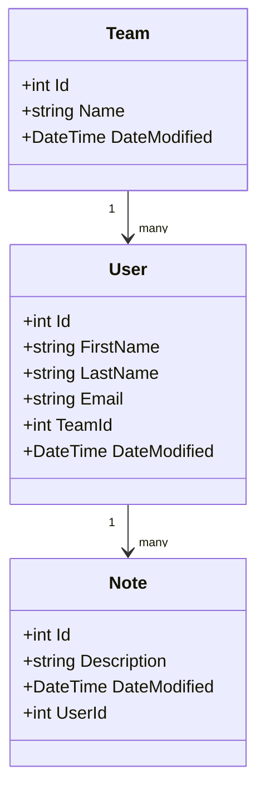

# bluestaq-assessment
Note Taking Service

Goal: Backend for a note-taking service used and shared amongst several small teams. Users need somewhere to capture and store notes.

Deliver a runnable REST service and README.

Choices:
- .NET
- SQLite database using Entity Framework Core Code First

## Schema Design

This schema matches the project goals:
- A Team contains many Users
- A User belongs to one Team
- A User can have many Notes
- A Note belongs to one User

Using consistent C#-style naming, the entities are:

- Team: Id, Name, DateModified
- User: Id, FirstName, LastName, Email, TeamId, DateModified
- Note: Id, Description, DateModified, UserId



## Entity Relationships

- Team 1-to-many User
- User 1-to-many Note
- The `TeamId` foreign key links a user to their team
- The `UserId` foreign key links a note to its owner

## Data Storage Plan

The service now uses SQLite with Entity Framework Core Code First.

The database file is:

- `NoteTakingService.db`

The schema is generated automatically when the app starts, with tables for:

- `Teams`
- `Users`
- `Notes`

## Executable Option

This project can be run either as a standard .NET app or as a self-contained Windows executable.

### Standard app run

```bash
dotnet run
```

### Self-contained Windows EXE

To build a self-contained Windows x64 executable that can run without installing the .NET runtime on the target machine:

```bash
dotnet publish .\NoteTakingService\NoteTakingService.csproj -c Release -r win-x64 --self-contained true -p:PublishSingleFile=true -p:UseAppHost=true -o .\artifacts\selfcontained-win-x64
```

This produces a runnable file at:

```text
.\artifacts\selfcontained-win-x64\NoteTakingService.exe
```

The generated EXE is local build output and is not intended to be committed to source control by default. It is appropriate for a Windows desktop or local demo environment where you want to run the API without requiring `dotnet` to be installed.

## CRUD API

The .NET service includes database-backed CRUD operations for all three entities:

- Teams: `GET /api/team`, `GET /api/team/{id}`, `POST /api/team`, `PUT /api/team/{id}`, `DELETE /api/team/{id}`
- Users: `GET /api/user`, `GET /api/user/{id}`, `GET /api/user/team/{teamId}`, `POST /api/user`, `PUT /api/user/{id}`, `DELETE /api/user/{id}`
- Notes: `GET /api/note`, `GET /api/note/{id}`, `GET /api/note/user/{userId}`, `POST /api/note`, `PUT /api/note/{id}`, `DELETE /api/note/{id}`

The data layer uses Entity Framework Core with a shared `NoteTakingDbContext` and SQLite persistence.

## Sample API Calls

The app runs at:

```bash
http://localhost:5256
```

Note: On Windows PowerShell, `curl` is an alias for `Invoke-WebRequest`, which makes JSON payloads awkward. The most reliable option is `Invoke-RestMethod`.

### Get All Teams

```powershell
Invoke-RestMethod -Method Get -Uri "http://localhost:5256/api/team"
```

### Get All Users

```powershell
Invoke-RestMethod -Method Get -Uri "http://localhost:5256/api/user"
```

### Get All Notes

```powershell
Invoke-RestMethod -Method Get -Uri "http://localhost:5256/api/note"
```

### Create a Team

```powershell
$body = @{ name = "BlueStaq" } | ConvertTo-Json
Invoke-RestMethod -Method Post -Uri "http://localhost:5256/api/team" -ContentType "application/json" -Body $body
```

### Update a Team

```powershell
$body = @{
  id = 1
  name = "BlueStaq Consulting"
  dateModified = "2026-11-02T00:00:00Z"
} | ConvertTo-Json

Invoke-RestMethod -Method Put -Uri "http://localhost:5256/api/team/1" -ContentType "application/json" -Body $body
```

### Delete a Team

```powershell
Invoke-RestMethod -Method Delete -Uri "http://localhost:5256/api/team/1"
```

### Create a User

```powershell
$body = @{
  firstName = "Avery"
  lastName = "Brooks"
  email = "avery.brooks@bluestaq.com"
  teamId = 1
} | ConvertTo-Json

Invoke-RestMethod -Method Post -Uri "http://localhost:5256/api/user" -ContentType "application/json" -Body $body
```

### Update a User

```powershell
$body = @{
  id = 1
  firstName = "Avery"
  lastName = "Brooks"
  email = "avery.brooks@bluestaq.com"
  teamId = 1
  dateModified = "2026-11-02T00:00:00Z"
} | ConvertTo-Json

Invoke-RestMethod -Method Put -Uri "http://localhost:5256/api/user/1" -ContentType "application/json" -Body $body
```

### Delete a User

```powershell
Invoke-RestMethod -Method Delete -Uri "http://localhost:5256/api/user/1"
```

### Create a Note

```powershell
$body = @{
  description = "Reviewed project kickoff checklist and assigned team owners."
  userId = 1
} | ConvertTo-Json

Invoke-RestMethod -Method Post -Uri "http://localhost:5256/api/note" -ContentType "application/json" -Body $body
```

### Update a Note

```powershell
$body = @{
  id = 1
  description = "Reviewed kickoff checklist and assigned final owners."
  userId = 1
  dateModified = "2026-11-02T00:00:00Z"
} | ConvertTo-Json

Invoke-RestMethod -Method Put -Uri "http://localhost:5256/api/note/1" -ContentType "application/json" -Body $body
```

### Delete a Note

```powershell
Invoke-RestMethod -Method Delete -Uri "http://localhost:5256/api/note/1"
```

## Quick Start

From the project directory:

```bash
cd NoteTakingService
dotnet restore
dotnet run
```

Then open:

- `http://localhost:5256/docs`
- or `http://localhost:5256/openapi/v1.json`

The app listens on:

- `http://localhost:5256`

## Assumptions / MVP Limits

This project is intentionally simple and intended for local development and evaluation.

- SQLite is used for persistence, not a production-grade enterprise database
- There is no authentication or authorization yet
- The API exposes EF Core entities directly instead of DTOs
- There is no pagination, filtering, or sorting
- There is no deployment packaging or installer yet
- This is a learning/demo app, not a hardened production service

## Running the Service

From the project directory:

```bash
cd NoteTakingService
dotnet run
```

This uses the HTTP profile for local development and keeps the setup simple for new team members.

The app will run on:

- `http://localhost:5256`

Open API docs:

- `http://localhost:5256/docs`
- `http://localhost:5256/openapi/v1.json`

